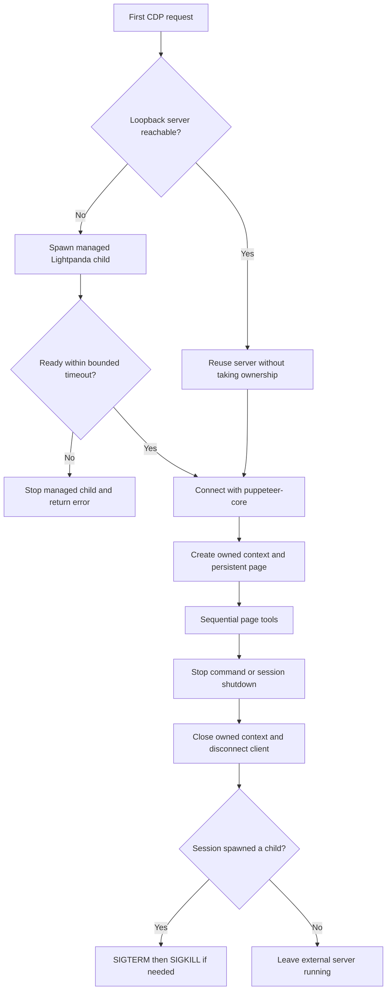
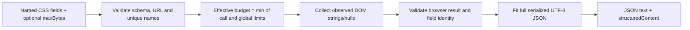

# Architecture and maintenance

## Small modules, explicit ownership

| File | Responsibility |
|---|---|
| `index.ts` | Tool schemas/registration, configuration, bounded text output, refs, commands and Pi lifecycle hooks |
| `browser.ts` | Loopback CDP connection, managed process startup/shutdown and owned browser context/page |
| `extract.ts` | Extraction schema, serializable DOM collector, required-field priority and valid-JSON fitting |
| `setup.ts` | Call-time binary resolution, release metadata, bounded streaming download, digest verification and atomic installation |

There is no build step. Pi loads TypeScript directly; `puppeteer-core` is the
only runtime dependency and does not download Chromium. Pi supplies TypeBox and
the extension API. Node types target the minimum supported Node 22 runtime.

Each extension factory creates its own browser session and ref map. There are
no module-global browser handles. A managed server is identified by the child
handle the session actually spawned, not by a second ownership flag that can
get out of sync. Tools that share the page run sequentially. Concurrent startup
requests also share a single startup promise as a defensive measure.

## Lifecycle: own the context, not an external browser

Cancellation is checked before publishing newly opened resources. A connection
that finishes after shutdown is closed rather than resurrecting an ended
session. Cleanup is idempotent. A binary update never restarts an external
server and asks before discarding a managed browser's page/cookies.

Refs point to unique temporary DOM markers rather than potentially duplicated
IDs/classes. Navigation, actions (including failed actions), arbitrary evaluation,
stop and restart invalidate the ref map. Reading known fields without navigation
does not invalidate refs.

## Extraction: bounded does not mean broken JSON

Extraction retains its existing 64 KB cap. DOM transfer uses a character quota;
final fitting accounts for JSON escaping and UTF-8 bytes. Both stages prioritize
required fields, then share space within each tier, independent of request order.
This two-stage design is intentional: a short required price must not be starved
by an earlier optional list. The collector is self-contained because Puppeteer
serializes it into a different JavaScript environment; do not extract its helpers
into Node closures.

Partial optional data sets `truncated`; missing/ambiguous/redacted data has an
explicit status. A required field that cannot fit fails the tool. If metadata
cannot fit, return an explanatory error, never a sliced JSON document. Raw
attributes are not interpreted as absolute URLs, numbers or facts.

## Tests: few fixtures, distinct behavioural contracts

All offline tests use `node:test`, strict assertions and the single registration
harness in `test-support.ts`. Artifact verification runs separately so the npm
pack subprocess does not slow every unit/coverage run; `npm run check` includes
both. No browser downloads, external sites or nested LLM
calls are needed. Mocks sit at process/HTTP/CDP boundaries; the registered tool
implementations themselves execute unchanged.

| Suite | Contract |
|---|---|
| `helpers.test.ts` | Configuration boundaries, binary/platform selection, UTF-8 text and snapshot formatting |
| `setup.test.ts` | Streaming progress, successful updates, confirmation and malformed release metadata |
| `reliability.test.ts` | Download/install recovery, process lifecycle, refs, cancellation and external resource preservation |
| `extraction.test.ts` | Schema/provenance, observed values, missing/required fields, both budget stages and cancellation at each wait |
| `browser-contract.test.ts` | Real fake executables, all action paths, tool errors, commands and cross-instance isolation |
| `package-check.ts` (`test:package`) | Published entrypoints/imports/docs present; development files excluded |
| `smoke.ts` | Opt-in real Lightpanda integration using ephemeral loopback servers and versioned page fixtures |

Prefer adding a row to an existing boundary/case table over duplicating fixture
setup. Do not remove distinct failure cases just to lower the test count. Avoid
assertions about function arity, source keywords or literal command builders
when a behaviour-level test already checks the actual process arguments.

`npm run test:coverage` enforces aggregate floors of 90% lines, 80% branches and
85% functions across all four production modules. Coverage is a regression
signal, not proof of correctness; platform-specific process behaviour still
needs the CI matrix and real CDP behaviour still needs the smoke check. The
manual CI dispatch installs a verified upstream nightly before running smoke;
ordinary PRs run offline tests without relying on nightly/GitHub availability.

## Dependency and release safety

Use the lockfile with `npm ci --ignore-scripts` for reproducible development and
CI. GitHub Actions are pinned to commit hashes, with version comments so
Dependabot can propose reviewed updates. CI has read-only repository access;
the release workflow alone needs release/write permissions and publishing
credentials. Releases are serialized and rerun the local quality gate before
semantic-release.

Separate shipped dependency advisories (`npm audit --omit=dev`) from development
and release-tool advisories (`npm audit`). Prefer compatible fixes. An advisory
inside npm bundled by semantic-release may require an upstream release rather
than a forced downgrade or an untested major dependency override. Never call
such a repository vulnerability-free merely because its production audit is
clean.
